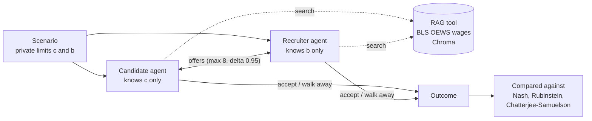
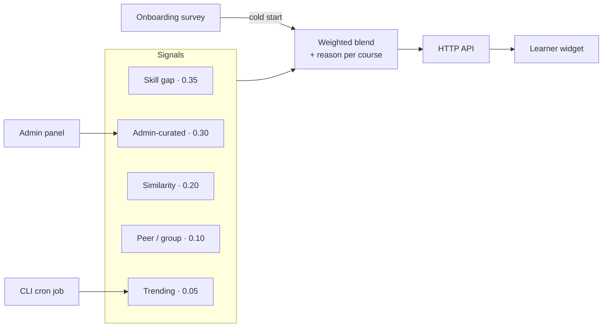

# Prachiti Kulkarni

**Software & AI/ML Engineer** · M.S. Computer Engineering, NYU Tandon (May 2027)

New York, NY · Open to relocation anywhere in the US

---

### About

I build systems end to end, from the data pipeline and the model to the API and the screen a learner or user actually sees. My recent work spans LLM agents with retrieval, explainable recommendation engines, and Spark pipelines over millions of records.

- **Currently:** building a game-theory study of RAG-powered LLM negotiation agents at NYU
- **Previously:** Intern at Vowel LMS (course recommendations) · Research Intern at the Institute of AI, MIT World Peace University
- **Looking for:** new-grad 2027 roles in software engineering, data, and AI/ML

---

### At a Glance

| ~10M | 83% | 500+ | 5 |
|:---:|:---:|:---:|:---:|
| taxi trips processed in under 3 minutes with PySpark | accuracy classifying lung cancer from CT scans | active users served by a team MLOps feature | weighted signals in an explainable course recommender |

---

### Featured Work

#### AI vs. AI Salary Negotiation · Game Theory of RAG-Powered LLM Agents
`In progress` · `LangGraph` `LangChain` `RAG` `Chroma` `Llama 3`

A candidate agent and a recruiter agent negotiate a salary, each knowing only its own private limit. On every turn an agent can offer, accept, walk away, or search a salary database first.

- Pipeline runs end to end, with 4 of 4 tests passing on scripted test models
- Optional, logged RAG tool: BLS OEWS wages by job and city in a Chroma vector store behind a LangChain retriever
- Derived the Chatterjee-Samuelson equilibrium and checked it by simulation: with private limits it loses 44% of feasible deals while keeping 84% of possible gains
- Nash bargaining and Rubinstein benchmarks for a 4-setup 2x2 AI-adoption game
- Next: Llama 3 runs (4 setups x 100 negotiations), bootstrap stability analysis, and a detector that flags agents revealing their private limits. Repository goes public in December 2026.

<b>View architecture</b>

 

#### Vowel LMS · Explainable Course Recommendation Feature
`PHP 8.4` `MySQL` `Joomla 5` `Python` · [Repository](https://github.com/Prachiti22/vowel-lms-course-recommendation-feature)

A deterministic recommendation engine added to a production Techjoomla LMS. It blends five weighted signals into one ranked list per learner and shows the reason on every card.

- Weights: skill gap 0.35, admin-curated 0.30, similarity 0.20, peer/group 0.10, trending 0.05
- Delivered as an HTTP API, a learner dashboard widget, an admin panel, and a CLI for the daily trending-cache job
- Cold-start learners are handled with an onboarding survey, then featured and popular courses
- Six add-only SQL tables read existing LMS data without modifying it; API endpoints and event logging capture user interaction metrics
- Python seed pipeline generates test data

<b>View architecture</b>

 

#### NYC Yellow Taxi Analysis & Demand Prediction
`PySpark` `Spark SQL` `Spark MLlib` · [Repository](https://github.com/Prachiti22/Big-Data-Project)

Three-person NYU Big Data project: an end-to-end PySpark pipeline over NYC TLC trip records (January to March 2023).

- ~10M trips processed in under 3 minutes on a 4-core local Spark cluster
- Random Forest hourly demand model: RMSE ~41 trips/hour, R² ~0.87
- IQR and rule-based anomaly detection flagged ~1.2% of trips
- My part: preprocessing and feature engineering, the MLlib demand model, anomaly detection, and the Spark SQL analytics and report

#### DeepTumorNet · Lung Cancer Classification
`TensorFlow` `CNNs` `MLflow` `DVC` · [Repository](https://github.com/Prachiti22/Lung-Cancer-Classification)

Transfer learning on CT scans comparing ResNet, InceptionV3 and NASNetMobile, reaching 83% accuracy, with MLflow experiment tracking and DVC data versioning.

#### SpendSense · Transaction Categorization MLOps for Firefly III
`MLOps` `Docker` `Chameleon Cloud` · [Team repository](https://github.com/more-piyush/SpendSense)

Team project adding ML-based transaction categorization to the open-source Firefly III finance app, served to 500+ active users. As Core Data Member I built a time-split preprocessing pipeline that prevents data leakage across 4.5M deduplicated, stratified records, and a feedback loop that logs user corrections and triggers weekly retraining.

#### ALTTIORA · Real Estate Website
`HTML` `CSS` `JavaScript` · [Live site](https://alttiora.netlify.app)

Responsive 6-page website for a real estate firm in Pune, scoped directly with the owner.

<b>More projects</b>

 

| Project | Description | Stack |
|---|---|---|
| [Gadget Galaxy](https://github.com/Prachiti22/Gadget-Galaxy) | Full-stack e-commerce storefront with Stripe payments and a Sanity CMS backend | JavaScript, Stripe, Sanity |
| [School Administration Program](https://github.com/Prachiti22/school-administration-program) | School management system for records and administration | Python |
| [Finlatics Data Science](https://github.com/Prachiti22/Finlatics) | Notebooks from the Finlatics Data Science Program | Python, Jupyter |
| [Data Structures](https://github.com/Prachiti22/Data-Structure) | Implementations of core data structures | |

---

### Technical Skills

| | |
|---|---|
| **LLMs & Agents** | LangGraph, LangChain, RAG, Chroma, Ollama (Llama 3), LLM APIs, prompt engineering |
| **Machine Learning** | TensorFlow, PyTorch, Scikit-learn, OpenCV, CNNs, MLflow, DVC |
| **Data** | Apache Spark (PySpark, Spark SQL, MLlib), Kafka, ETL, Pandas, Matplotlib, Power BI |
| **Languages** | Python, Java, C, C++, C#, JavaScript, TypeScript, SQL, PHP, HTML/CSS, Bash |
| **Web & Backend** | React, Angular, Node.js, Express, FastAPI, Flask, Spring, REST APIs |
| **Data Stores & Infra** | PostgreSQL, MySQL, Docker, Kubernetes, AWS, Terraform, GitHub Actions, Linux |

---

### Research

- **Enhanced Particle Swarm Optimization** (Institute of AI, MIT-WPU): 93% test accuracy with an enhanced PSO algorithm implemented in Python
- **Patent:** AI-Based Sleep Quality Enhancement (2025)
- **Book chapter** · **MACO paper** under review

---

### Experience & Education

| | | |
|---|---|---|
| **Intern, Course Recommendations Feature** | Vowel LMS (remote) | May 2026 – Aug 2026 |
| **Research Intern** | Institute of AI, MIT World Peace University | Jul 2024 – Jan 2025 |
| **M.S. Computer Engineering**, GPA 3.77 | New York University, Tandon School of Engineering | May 2027 |
| **B.Tech Computer Science and Engineering** | MIT World Peace University | 2025 |
